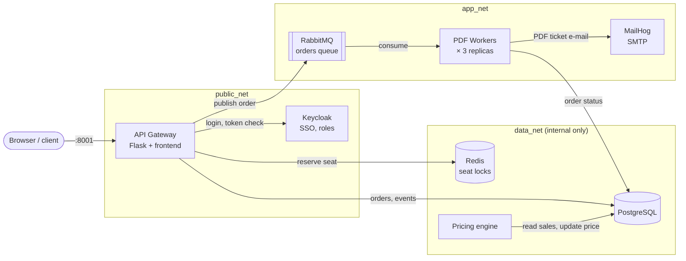
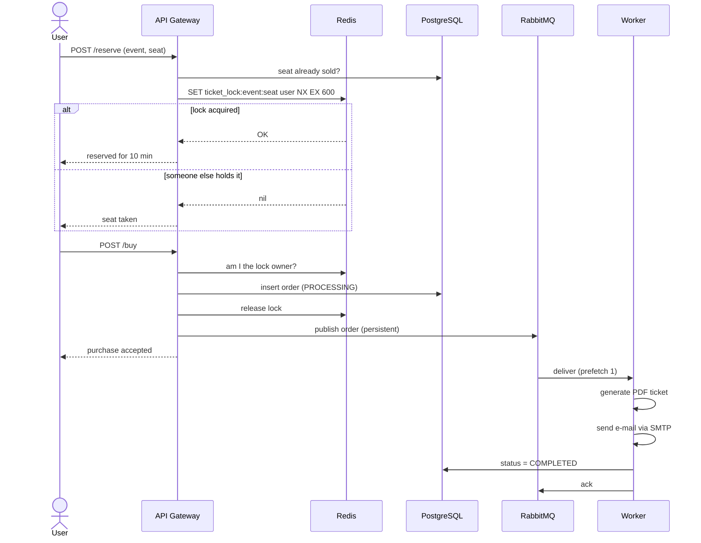

# TicketFlow


A distributed event-ticketing platform built as **8 services on Docker Swarm**.
The core problem it solves is **high concurrency**: many users trying to buy the same seat at the same time, without ever selling it twice.

Built for the Concurrent and Distributed Systems course at UPB (Jan–Mar 2026).

## Highlights

- **No double-booking**: a seat is reserved with a Redis lock (`SET NX EX`), so only one user can hold it, for 10 minutes.
- **Fast checkout**: the purchase returns immediately; PDF tickets and e-mails are produced in the background by **3 worker replicas** consuming a RabbitMQ queue.
- **Reliable messages**: durable queue, persistent messages, manual acks and `prefetch_count=1`, so a crashed worker's job goes back to the queue and work is spread fairly.
- **SSO + roles**: Keycloak handles login; only users with the `admin` role can create, edit or delete events.
- **Dynamic pricing**: a background service raises an event's price by 10% when 5+ tickets sell within a minute (capped at 500).
- **Network isolation**: the database and Redis live on an internal network that is never exposed to the outside.

## Architecture



The gateway is the only service on all three networks. Workers can reach the queue and the database, but not the outside world; PostgreSQL and Redis are reachable only from inside `data_net`.

## How buying a ticket works



## Run it

Requires Docker with Swarm mode.

```bash
cd Project
docker swarm init                                   # once
docker compose build                                # build gateway, worker and pricing images
docker stack deploy -c docker-compose.yml ticketflow
docker service ls                                   # check that all services are up

docker service scale ticketflow_worker=5            # scale the PDF workers
docker service logs -f ticketflow_worker            # watch them share the queue

docker stack rm ticketflow                          # stop everything
```

| Service | URL | Demo login |
| --- | --- | --- |
| Web app | http://localhost:8001 | `user1` / `1234` |
| Keycloak admin | http://localhost:8080 | `admin` / `admin` |
| RabbitMQ dashboard | http://localhost:15672 | `guest` / `guest` |
| MailHog inbox | http://localhost:8025 | — |

The credentials are local demo defaults only.

## API

| Endpoint | Method | Description |
| --- | --- | --- |
| `/login` | POST | Log in through Keycloak, returns a token |
| `/events` | GET | List events with remaining seats |
| `/events` | POST | Create an event (admin) |
| `/events/<id>` | PUT / DELETE | Edit or delete an event (admin) |
| `/events/<id>/seats` | GET | 10×10 seat map: free, reserved or sold |
| `/reserve` | POST | Reserve a seat for 10 minutes (Redis lock) |
| `/buy` | POST | Buy the reserved seat and queue the ticket |
| `/orders/<id>` | GET | Order status |

## Testing

- **Concurrency test**: `run_load_test.sh` runs `load_test.py` inside the gateway: 6 simulated users (one thread each, each with its own Keycloak token) race for the seats of the same event until it sells out, while the worker logs stream live. Losing a race shows up as "already taken" and the user picks another seat.
- **API tests**: a Postman collection and environment in `Project/Tests/`.

## What I would improve

- **Safe lock release**: release only if I still own the lock, atomically (a small Lua compare-and-delete script). Today an expired lock re-taken by another user could be deleted by the first one.
- **Database as the last line of defense**: a unique constraint on `(event_id, seat_id)` for active orders, so a bug in the locking can never produce a double sale.
- **Reuse the RabbitMQ connection** instead of opening a new one per purchase.
- **Retry with a dead-letter queue** instead of requeueing a failing message forever.
- **Secrets in Docker secrets / env files**, not in `docker-compose.yml`.
